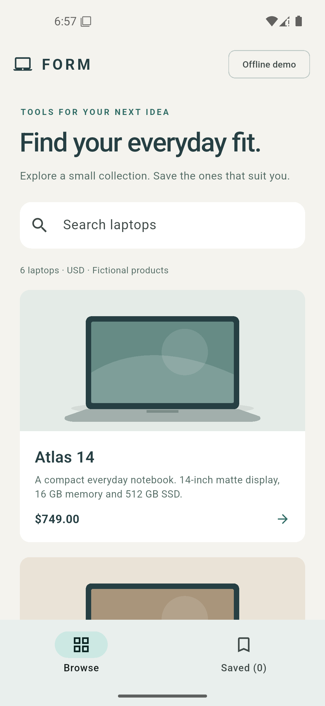

# Form · Laptop browser

A Flutter catalog for exploring laptops and keeping a shortlist on your device. Includes search, readable details, persistent favorites, an offline demo and an optional catalog API connection.



This is a refreshed portfolio edition of an earlier technical exercise. The current implementation, demo data and interface were revised in 2026. It is a local learning/demo application; deployment, accounts and production operations are outside its scope.

## Run

Tested with Flutter **3.35.6 / Dart 3.9.2**. The default demo runs without an account or external service.

```sh
flutter pub get
flutter run -d chrome --web-port 4441
```

Or select an Android device with `flutter devices`, then run `flutter run -d <device-id>`. Android builds need a working Android SDK/JDK and accepted SDK licenses. No iOS runner is included or validated in this edition.

## Walkthrough

1. Search for `Atlas` and open its details.
2. Choose **Save laptop**, return to Browse and open **Saved**.
3. Restart the app: the shortlist remains on the same device/browser origin.
4. Remove the saved laptop and try a search with no matches.

The 6 bundled products and their prices are fictional. The laptop illustrations are original vector drawings. This app is a catalog and shortlist; account registration and checkout are outside its scope.

## Optional API mode

Run the companion [Catalog Scraper](https://github.com/KallasLima/catalog-scraper), then pass its base URL at build/run time:

```sh
flutter run -d chrome --web-port 4441 --dart-define=API_URL=http://127.0.0.1:4411
```

For a cross-origin browser build, start that API with `CLIENT_ORIGIN` set to the exact UI origin displayed by Flutter, such as `http://localhost:4441`. It allows one explicit origin. For an Android emulator use `API_URL=http://10.0.2.2:4411`. Alternatively use `adb reverse tcp:4411 tcp:4411` and `http://127.0.0.1:4411`.

The debug Android configuration permits cleartext only for local development hosts. Remote APIs must use HTTPS. A release build requires HTTPS for network access.

`GET /api/laptops` returns `{items:[{id,title,description,price}]}`. Prices are integer USD cents. Requests time out after 12 seconds; invalid payloads and failed requests show a retry screen. API mode is a compile-time choice: changing the URL needs a new run/build.

## Code

- `lib/catalog.dart`: validated model, asset/API repository and timeout.
- `lib/main.dart`: catalog load lifecycle, query, navigation and shortlist persistence.
- `lib/laptop_detail.dart`: scrollable detail screen and saved-state control.
- `lib/widgets/laptop_art.dart`: vector illustration.
- `assets/laptops.json`: authored offline data.

Favorites use the scoped `laptop_browser.saved.v1` SharedPreferences key. Other preferences are left alone. Loading happens once in the page lifecycle rather than during build. Saved-state writes are acknowledged before updating the UI; failures are visible. Favorites store product IDs, so products absent from a later API response are not shown until they return. No personal data or account tokens are stored.

## Verify

```sh
dart format --output=none --set-exit-if-changed lib test
flutter analyze
flutter test
flutter build web
flutter build apk --debug
```

Tests cover fixture parsing, malformed/failed API responses, search, details and a persisted favorite without overwriting unrelated preferences. Android validation exercises the actual installed app. Web output can be served from `build/web` by any local static server; Flutter’s renderer may load engine/font resources on first use. Bundled demo data means no catalog API is required.

Flutter, Material/Cupertino icons and packages retain their licenses. A distribution license for this project has not been selected.
